# Plan 7: the app interface

## Goal

A new interface for the app: one window, three independent sections reached from a three
item toolbar at the bottom of the screen. The first section checksums a file, the second
checksums a folder, the third compares two sources. Each section keeps its own state and
its own results, and each can run while another is running.

The base surface is the system background — white in light mode, black in dark mode — and
every control is a standard SwiftUI component, so the interface inherits the system look,
the system motion, and the system accessibility behaviour without custom drawing.

Mockups for everything described here are in [`images/gui`](images/gui) and embedded
below.

## Shape

```
RootView
  TabView(selection: app.selectedSection)
    FileSectionView      NavigationStack(path: file.path)
      picker page        "Checksum File…"
      result page        metadata, key/value pairs, share
    FolderSectionView    NavigationStack(path: folder.path)
      picker page        "Checksum Folder…"
      result page        progress, then table, share
    CompareSectionView   NavigationStack(path: compare.path)
      picker page        two sources, Compare
      result page        spinner, then tree of diff sections, share
```

The bottom toolbar is a `TabView` with three `Tab`s (File, Folder, Compare). It is the
standard component, so it is the floating, translucent, Liquid Glass bar on the current
system and the plain tab bar on older ones. No custom bar is drawn.

Each section is a `NavigationStack` whose path lives in that section's model. Picking a
source appends `.result` to the path, which gives the slide-in from the right for free,
and the back button in the result toolbar pops it. Switching tabs does not destroy a
section: the three stacks, their tasks and their results live in `AppModel` for the
lifetime of the window.

## Orientation and width

Every section runs in every orientation; nothing is locked. The layout follows the width
of the content container, measured with `onGeometryChange`, against a single 700 point
breakpoint — not the orientation — so an iPhone in landscape (about 844 points), an iPad
in either orientation, and a resized Mac window all get the wide layout, while an iPhone
in portrait and a narrow iPad split view get the compact one.

| | Compact (< 700 pt) | Wide (≥ 700 pt) |
|---|---|---|
| Shell | bottom tab bar | the platform's standard tab bar placement |
| File result | key/value card, full width | key/value card centred, max width 640, pairs in two columns |
| Folder result | two-line rows: name and size, then checksum and date | `Table` with Name, Size, Created, Modified, Checksum |
| Compare picker | two stacked source cards | the two cards side by side |
| Compare result | collapsible sections of the same two-line rows | `Table` with the same columns, sections as disclosure rows |

Only the container and the row density change. The row content, diff styling, models,
localization and tests are shared, which is what keeps the two presentations honest.
The wide mockups in each section below are the same screens rotated.

The tab bar is the standard one, so on iPhone it stays at the bottom in landscape and on
iPad and Mac it takes the platform's placement without extra code.

## Layers

Per `AGENTS.md`, the split is:

| Layer | Where | Owns |
|-------|-------|------|
| View | `csum/App`, `csum/Sections/*/*View.swift`, `csum/Shared` | Layout, animation, presentation modifiers, local expansion and scroll state, accessibility identifiers and labels |
| ViewModel | `csum/App/AppModel.swift`, `csum/Sections/*/*Model.swift` | Selected tab, per-section navigation path, source selection, load/result/error state, tasks, progress, export text, delayed-spinner flag |
| Controller | `Sources/CsumController` | Filesystem access, checksumming, diffing, `.csum.csv` reading and writing |
| Access / remote | none | — |

The models import Foundation and Observation only; no SwiftUI. The views contain no
file I/O, no checksumming, no formatting logic beyond calling the shared formatters.

### What each model owns

`AppModel`:

```swift
@MainActor @Observable
final class AppModel {
    enum Section: Hashable { case file, folder, compare }
    var selectedSection: Section = .file
    let file: FileSectionModel
    let folder: FolderSectionModel
    let 
: CompareSectionModel
}
```

`FileSectionModel` / `FolderSectionModel`:

```swift
enum Phase {
    case idle
    case running
    case loaded(ChecksumResult)
    case failed(message: String)
}

var phase: Phase
var path: [Route]                  // [] or [.result]
var isChoosingSource: Bool         // drives .fileImporter
var progress: (done: Int, total: Int)?
var showsDelayedSpinner: Bool      // file section only
var export: CsumCSVFile?           // non-nil only when loaded
```

`CompareSectionModel` adds `first: URL?`, `second: URL?`, `firstKind`, `secondKind`
(each `.csumFile` or `.folder`), `isChoosingFirst`, `isChoosingSecond`, and a `Phase`
whose loaded case carries `ChecksumComparison`. Both kinds start as `.csumFile`, and
changing a kind clears that side.

Everything derived is computed from the model: section results are never shared between
sections, and an error in one section leaves the other two untouched.

### Views

| View | Responsibility |
|------|----------------|
| `RootView` | `TabView` with the three sections and the tab labels/icons |
| `*SectionView` | The picker page: the centered button or the two source cards; the `.fileImporter` modifiers bound to the model's flags |
| `AdaptiveContent` | Measures the container and publishes the compact/wide choice; every result page and the compare picker read it |
| `*ResultView` | Switches on `model.phase`: progress/spinner, results, or error; hosts the result toolbar |
| `ChecksumTable` | The five shared columns and their cells; the folder result and the wide compare result both use it |
| `MetadataStrip` | Small secondary text above the results: root(s), computed time, format version |
| `ResultToolbar` | Back (leading, system) and `ShareLink` (trailing, disabled unless loaded) |
| `ErrorStateView` | Icon, localized message, nothing else; back stays, share is disabled |
| `DiffSectionView` / `DiffRowView` | The compact disclosure sections and the shared diff row content |

## The three sections

### File

Idle page: a single centered "Checksum File…" button on the system background. Tapping it
sets `isChoosingSource`, which presents `.fileImporter(allowedContentTypes: [.data])`.
Choosing a file:

1. appends `.result` to the path, so the result page slides in immediately;
2. starts the checksum task on the service;
3. arms a 500 ms timer. If the task is still running when it fires, `showsDelayedSpinner`
   becomes true. If the task finished first, the spinner never appears and the result is
   simply there.

Result page, top to bottom: the back/share toolbar; the metadata strip (absolute path,
computed date, format version); then either the spinner, the error, or the key/value
pairs: checksum (monospaced), algorithm, size, created, modified, path. Dates are
locale-formatted, not epoch numbers. On wide displays the card is centred at a maximum
width of 640 points and the pairs sit in two columns.

Share is enabled only in the loaded state and shares the rendered `.csum.csv` text.

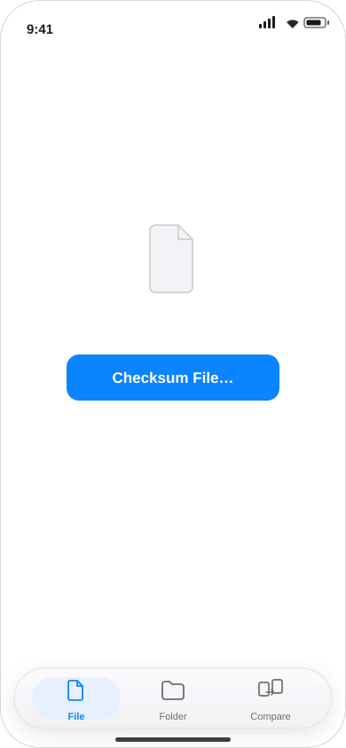

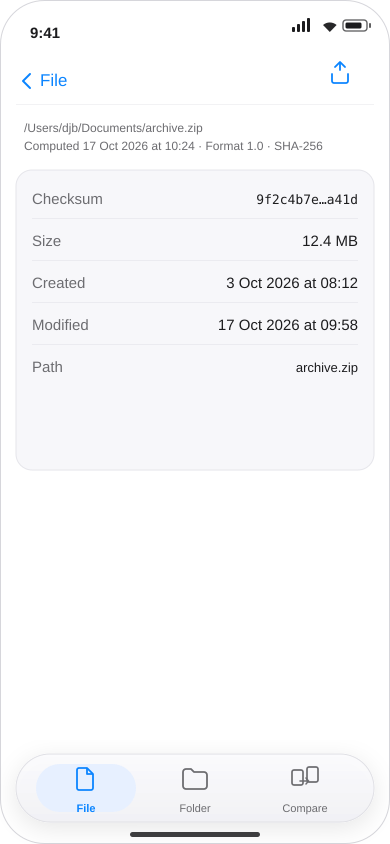

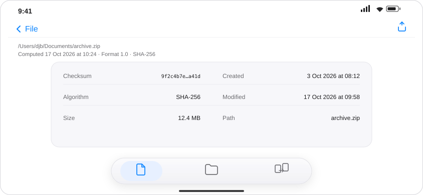

### Folder

Idle page: "Checksum Folder…" presents `.fileImporter(allowedContentTypes: [.folder])`.
Choosing a folder pushes the result page and starts the task. The result page shows a
determinate progress bar (`ProgressView(value:total:)`) with a label such as
"12,345 of 48,201 files", updated at most ten times a second, until the result arrives.

Then the results page shows the metadata strip — root, computed time, format version,
algorithm, entry count — and the entries. In the wide layout that is a `Table` with these
columns:

| Column | Content | Alignment |
|--------|---------|-----------|
| Name | path relative to the root | leading |
| Size | `ByteCountFormatStyle` (3.8 MB, 812 KB) | trailing |
| Created | locale date | trailing |
| Modified | locale date | trailing |
| Checksum | monospaced, middle-truncated, full value via VoiceOver and copy | trailing |

In the compact layout it is a `List` of two-line rows built from the same data: the name
and size on the first line, the checksum and date on the second. Both presentations are
virtualized, both key rows by `ChecksumEntry.path`, and both use the same cell views and
accessibility labels. Selection is enabled so a row can be copied. Thousands or hundreds
of thousands of rows scroll without materializing extra arrays.

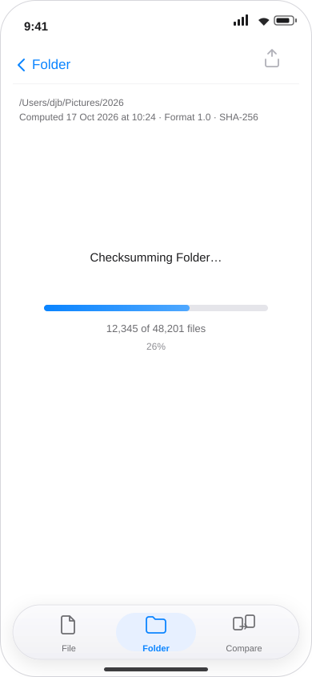

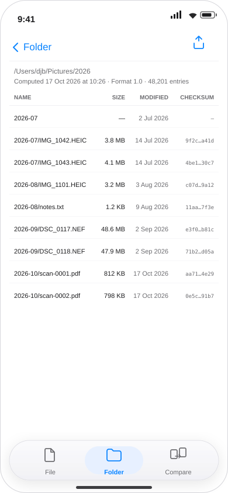

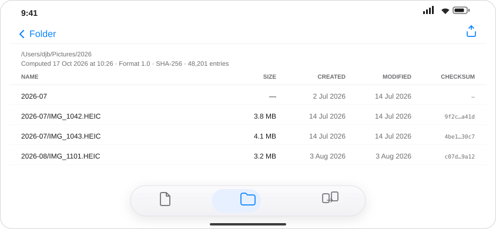

### Compare

The picker page has two source cards. Each card is one row of controls: a kind menu on the
left, offering **.csum.csv** or **Folder**, and a single **Choose…** button on the right
that opens the file dialog for that kind (`.commaSeparatedText` or `.folder`). The chosen
path is shown under the row. Changing the kind clears that side's selection, since a
folder cannot stand in for a checksum file. A swap control exchanges the two. Compare is
enabled only when both sides are set; it pushes the result page and starts the comparison,
which has no progress reporting, so the result page shows an indeterminate spinner.

The menu is a standard `Picker` with `.pickerStyle(.menu)` and the button is a standard
`Button`, so both are already accessible and already styled by the system.

The result page shows the metadata strip with **both** roots, both computed times and the
format version, then the counts, then the same entries the folder section renders, grouped
into collapsible sections in this order: Added, Removed, Changed, Moved, Renamed,
Unchanged. Each section header carries its count. Added, Removed and Changed start
expanded; the rest start collapsed; expansion is view state and resets with each new
comparison. A comparison with no differences shows a "No differences" state instead of an
empty list.

In the wide layout the sections are the same table as the folder page, with the same five
columns and a `DisclosureTableRow` per section, so a section expands and collapses in
place. In the compact layout the sections are `DisclosureGroup`s over the same two-line
rows. Diff symbols and emphasis live inside the shared cells, so the two presentations
cannot drift apart.

Share is enabled only when loaded, and exports `ComparisonFileCodec.render(comparison,
sections: ComparisonSection.allCases)`.

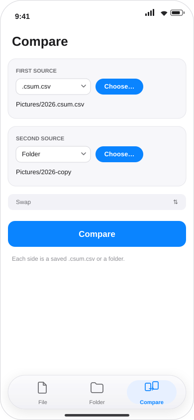

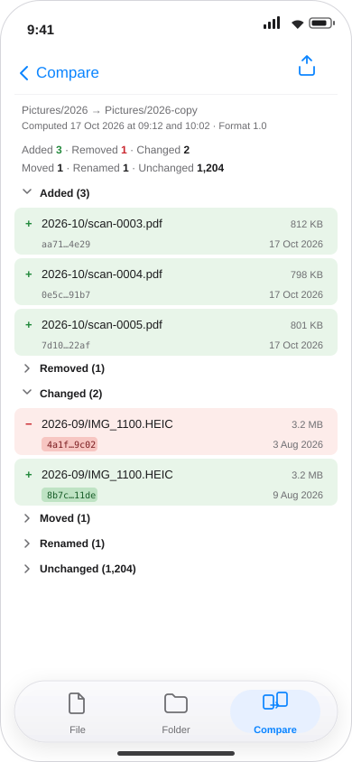

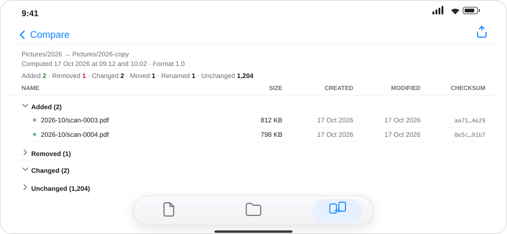

## Diff rows

Every row is one line of text plus a leading symbol, so the meaning survives without
colour and without sight. Added rows are green with `+`; removed rows are red with `−`;
unchanged rows are ordinary text. Changed, moved and renamed produce a pair: the old row
first, then the new row. In the wide table the symbol and the emphasis live in the Name
and Checksum cells of the shared table; in the compact rows they live in the same line
positions as the folder rows.


| Section | Symbol | Emphasis | Accessibility label |
|---------|--------|----------|---------------------|
| Added | `+`, green | none | "Added, path" |
| Removed | `−`, red | none | "Removed, path" |
| Unchanged | none | none | "Unchanged, path" |
| Changed | `−` / `+` | the checksum in both rows | "Changed, path, old checksum …, new checksum …" |
| Moved | `−` / `+` | the whole path in both rows | "Moved from …, to …" |
| Renamed | `−` / `+` | the leaf name in both rows | "Renamed from …, to …" |

Emphasis is an `AttributedString` background on the affected span, in colour assets with
light, dark and increased-contrast variants. The diff rows are the only place that needs
custom accessibility labels; everything else gets them from the standard components.

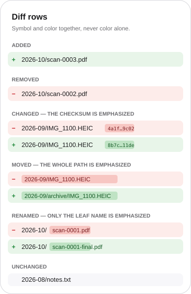

## Services

The controller is synchronous and CPU-bound, so the models talk to it through one
async boundary:

```swift
protocol Checksumming: Sendable {
    func checksum(
        at url: URL,
        progress: @Sendable (Int, Int) -> Void
    ) async throws -> ChecksumResult

    func compare(first: URL, second: URL) async throws -> ChecksumComparison
}
```

`ControllerService` wraps `CsumController`, runs each call on a detached user-initiated
task, and hops progress back to the main actor. The models throttle progress to ten
updates a second before publishing it. The protocol is what the unit tests fake; nothing
in the models refers to `CsumController` directly.

Two small controller additions are needed:

- `calculateChecksums` takes an optional `isCancelled: @Sendable () -> Bool`, checked per
  file, so leaving the section cancels promptly instead of hashing the rest of a tree.
  `compare` passes the same hook to both sides.
- a public `relativePath(of:root:)` helper (today the equivalent is private inside the
  comparison engine), so the folder table can show paths relative to the root.

Both are additive and covered by controller tests.

## Sharing

`CsumCSVFile` is a `Transferable` that writes its text to a temporary file with the given
name and declares `FileRepresentation(exportedContentType: .commaSeparatedText)`, so the
share sheet offers the right destinations for a CSV. The file section and the folder
section export `ChecksumFileCodec.render(result)`; the compare section exports
`ComparisonFileCodec.render(comparison)`.

`ShareLink(item: export, preview: SharePreview(fileName))` sits in the result toolbar and
is disabled (not hidden) unless the section is loaded, so it never disappears between
states.

## Formatting and localization

- One `Localizable.xcstrings` in the app target; every user-visible string is a `Text`
  literal or `String(localized:)`, including accessibility labels and the share filename
  (`Checksums for %@.csum.csv`).
- The catalog ships English (development language), Simplified Chinese (`zh-Hans`) and
  Arabic (`ar`), plus the double-length pseudo-locale that only the tests use. Traditional
  Chinese (`zh-Hant`) is a copy of the Simplified catalog once the copy is settled, and
  needs no code change. The app display name and the document type description live in
  `InfoPlist.xcstrings` so the name is localized with everything else.
- Counts use plural variants: "%lld file", "%lld files".
- Dates use `Date.FormatStyle` (`Text(date, format: .dateTime…)`); no hand-built strings
  and no epoch numbers in the UI.
- Sizes use `ByteCountFormatStyle`; counts use the default number format. Neither is
  concatenated with a hard-coded unit.
- Columns use `.leading`/`.trailing` rather than left/right, so the system mirrors them in
  right-to-left locales. Table cell text is `.multilineTextAlignment` on the same leading
  and trailing edges.
- Paths and checksums are rendered with `Text(verbatim:)` so they are not parsed as
  numbers or dates, and they get `.textSelection(.enabled)` where they are not in a table.
- The share filename is built from the localized template, not by string concatenation.

Arabic is the layout test that matters: the back button, the tab order, the label and
column alignment and the diff symbols all follow `.leading`/`.trailing`, so they mirror
with no per-locale code. Paths and checksums stay left-to-right inside an Arabic screen;
they are wrapped in bidi isolation (U+2066 … U+2069) wherever they are composed into a
localized sentence, such as a diff row's accessibility label.

Chinese changes the opposite risk: the strings are short, so labels must not be laid out
at fixed widths, and the table columns take their width from content rather than from the
English copy.

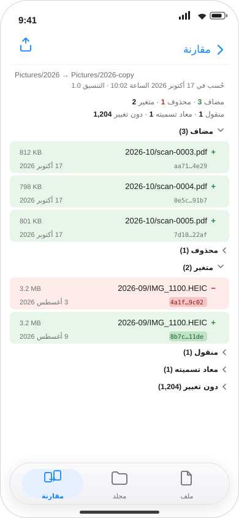

## Accessibility

Everything visible is a stock control, so labels, traits, focus order and rotor support
come for free: tabs, nav bars, buttons, the progress bar, the table and the share sheet.
On top of that:

- Diff rows combine their children and carry the labels in the table above; the symbol is
  hidden from VoiceOver because it is already in the label.
- The progress bar has a label ("Checksumming Folder…") and a value ("12,345 of 48,201
  files"); the delayed spinner has a label ("Checksumming…") and posts a live region
  announcement when it appears.
- The metadata strip is a set of `LabeledContent`s, so VoiceOver reads "Root, …", not a
  run-on line.
- Colour is never the only signal (symbol plus label), and the diff tints are tested in
  Increase Contrast and dark mode.
- Everything uses text styles and `@ScaledMetric` for icon and row padding, so Dynamic
  Type up to AX5 does not clip the toolbar, the metadata strip or the diff rows.
- UI tests run `performAccessibilityAudit()` on the idle, running, loaded and failed
  states of all three sections.

No other custom accessibility information is needed. The diff rows and the two live
announcements are the whole list.

## Errors

A failure in any section replaces that section's results with `ErrorStateView`: the
localized error message (the controller already conforms to `LocalizedError`), the back
button, and a disabled share. The tab bar stays usable; the other sections keep their
state and results. A cancelled task returns the section to idle rather than showing an
error.

## Large data

- The wide layouts are `Table`, which is virtualized; the compact layouts are `List`,
  which is virtualized too. Only visible rows render in either.
- No section copies its result into a second array. The folder views iterate
  `result.entries`; the compare views iterate the comparison's arrays; the diff emphasis
  is computed per visible row. The only extra array in the compare view is the list of
  section headers, not the rows.
- Expanding a huge section in the wide table builds no extra rows: the disclosure row
  renders its children from the comparison's own array.
- Rows are keyed by `entry.path` (already `Hashable`), so updates reuse rows.
- Progress is throttled in the model; the controller's callback is not forwarded to the
  main actor on every file.
- Target: a 100,000 entry folder result scrolls at full frame rate on an iPhone 16-class
  device, and the compare screen opens with 100,000 unchanged rows collapsed in under a
  second. Both are exercised in stub mode with a generated result.

## Choosing a source

All sources come from `.fileImporter` (single selection; `.data` for the file section,
`.folder` for the folder section, and whichever of `.commaSeparatedText` or `.folder`
matches the compare card's kind menu), which returns security-scoped URLs. The controller
already brackets each call with `startAccessingSecurityScopedResource`, so the models keep
the URL as the source and the security scope remains local to the controller call.

## Testing

### Controller

`swift test` covers checksumming, the diff, the formats and the new cancellation hook.
The existing suite also gains a test that a cancelled run stops before hashing the rest
of the tree and throws `CancellationError`.

### View models

A `FakeChecksumService` with continuations and a `TestClock` drive the section models
directly, with no SwiftUI and no file system:

- picking a source pushes the result route and enters `.running` before the task finishes;
- the file spinner is false at 499 ms and true at 501 ms if the task is still running, and
  never appears if the task completes first;
- a successful run yields `.loaded` with a non-nil export; a failed run yields `.failed`,
  a nil export, and the message;
- cancel on back returns to `.idle` and cancels the service task;
- compare is only startable with both sources;
- the three models are independent: running, failing or loading one does not change the
  other two, and switching tabs does not cancel a task.

### Views and flows

XCUITest targets, run against a stub service selected by a launch argument
(`-csumUITestMode stub`), so the tests do not depend on real files:

- file: idle → pick → result, spinner appears only for the slow stub;
- folder: progress label updates, then the table appears; 200 rows scroll;
- compare: one side `.csum.csv` and the other Folder enable Compare once chosen, changing
  a kind clears its side, results show the counts, sections expand and collapse in both
  the compact list and the wide table, the diff rows expose their labels;
- layout: rotate each section in every state (`XCUIDevice.shared.orientation`) from
  portrait to landscape and back, and assert the compact and wide presentations appear
  and keep the same data and header;
- error: a failing stub shows the message, share stays disabled, back works;
- localization: the same three flows under the double-length pseudolocale, in `zh-Hans`
  and in `ar`, asserting in Arabic that the back button, the tab order, the row alignment
  and the diff symbols sit on the mirrored edges while paths and checksums stay LTR;
- accessibility: `performAccessibilityAudit()` on every state;
- performance: signpost-style measure of scrolling a 100,000 row stub result.

Snapshot tests are optional and not part of the plan: the UI is built from standard
components whose rendering changes with the OS, so a snapshot suite would spend its life
being re-recorded. The accessibility audits and the flow tests are the durable check.

### Manual pass

Light and dark, iPhone and iPad, Mac Catalyst, Dynamic Type AX1 and AX5, Increase
Contrast, English, Simplified Chinese, Arabic and the pseudo-locale, VoiceOver through
each section, and the three share sheets. Rotate each section in each state, portrait and
landscape, and resize the Mac window across the 700 point breakpoint.

## Coverage

The controller and the models are the units worth measuring; the views are exercised by
the UI tests rather than by line coverage.

Controller (SwiftPM, macOS):

```sh
swift test --enable-code-coverage

xcrun llvm-cov report \
  .build/debug/CsumControllerTests.xctest/Contents/MacOS/CsumControllerTests \
  -instr-profile .build/debug/codecov/default.profdata \
  -ignore-filename-regex 'Tests/|\.build/'
```

That currently reports 91.60% of lines, 93.01% of functions and 94.96% of regions across
the controller. Per-file numbers come from the same command, and
`xcrun llvm-cov show … --show-line-counts-or-regions` shows the unexecuted lines. For a
CI artifact, `xcrun llvm-cov export -format=lcov` writes the same data as LCOV;
`swift test --enable-code-coverage --show-codecov-path` prints the profile path.

App and view models (Xcode, Mac Catalyst destination — no simulator needed):

```sh
xcodebuild test \
  -project csum.xcodeproj -scheme csum \
  -destination 'platform=macOS,variant=Mac Catalyst' \
  -enableCodeCoverage YES -resultBundlePath build/coverage.xcresult

xcrun xccov view --report build/coverage.xcresult
xcrun xccov view --report --json build/coverage.xcresult > build/coverage.json
```

`-only-testing:csumTests` limits the run to the model tests. The UI tests run on an iOS
simulator destination for the accessibility audit, with the same coverage flags if their
coverage matters.

Targets: 90% of lines in the section models and the service adapter; 100% of the state
transitions listed under "View models". Coverage of SwiftUI view bodies is not a goal and
is excluded with `-ignore-filename-regex`.

The package and the app are Apple-only (`CryptoKit`, SwiftUI), so none of this runs on the
Linux CI workflows; coverage needs a macOS runner, or a developer machine.

## Work order

1. **Target reset.** Remove the current app sources and their target membership, point the
   app target at the `CsumController` package product, set the deployment targets, add the
   string catalog and the diff colour assets. The target builds and launches empty.
2. **Plumbing.** `Checksumming` + `ControllerService`, the controller cancellation hook
   and relative-path helper, `CsumCSVFile`, the shared formatters. Controller tests green.
3. **Shell.** `AppModel`, `RootView`, the three tabs, empty section pages, and the
   `AdaptiveContent` width container.
4. **File section.** Picker, route, delayed spinner, key/value result (one column compact,
   two columns wide), error, share.
5. **Folder section.** Progress, compact rows and the wide table, metadata, error, share.
6. **Compare section.** Two sources with their kind menus, swap, spinner, collapsible
   sections in both presentations, diff rows, error, share.
7. **Localization and accessibility.** String catalog complete in `en`, `zh-Hans` and
   `ar`, `InfoPlist.xcstrings` covering the display name, audits clean in both directions,
   pseudo-locale pass.
8. **Tests and coverage.** Model tests, UI tests, coverage commands wired up.
9. **Performance pass.** 100,000 row stub, scroll and open timings recorded.

## Decisions

- **iOS 18 / macOS 15 deployment floor.** `@Observable` needs it; Liquid Glass itself
  needs no floor because it comes from the SDK.
- **Compact rows below 700 points, the five-column table at or above it.** This is a first
  cut; the breakpoint is one condition in `AdaptiveContent`, so it can move after the
  layout has been seen on a device.
- **Compare sources are `.csum.csv` or Folder** per side, picked with the kind menu. The
  controller also accepts a bare file, but the picker does not offer it.
- **Drag and drop is out.** It is additive later (`dropDestination(for: URL.self)`) and
  changes nothing in the models.
- **Locales are English, Simplified Chinese (`zh-Hans`) and Arabic (`ar`).** Traditional
  Chinese (`zh-Hant`) is a copy of the Simplified catalog once the copy is settled.
